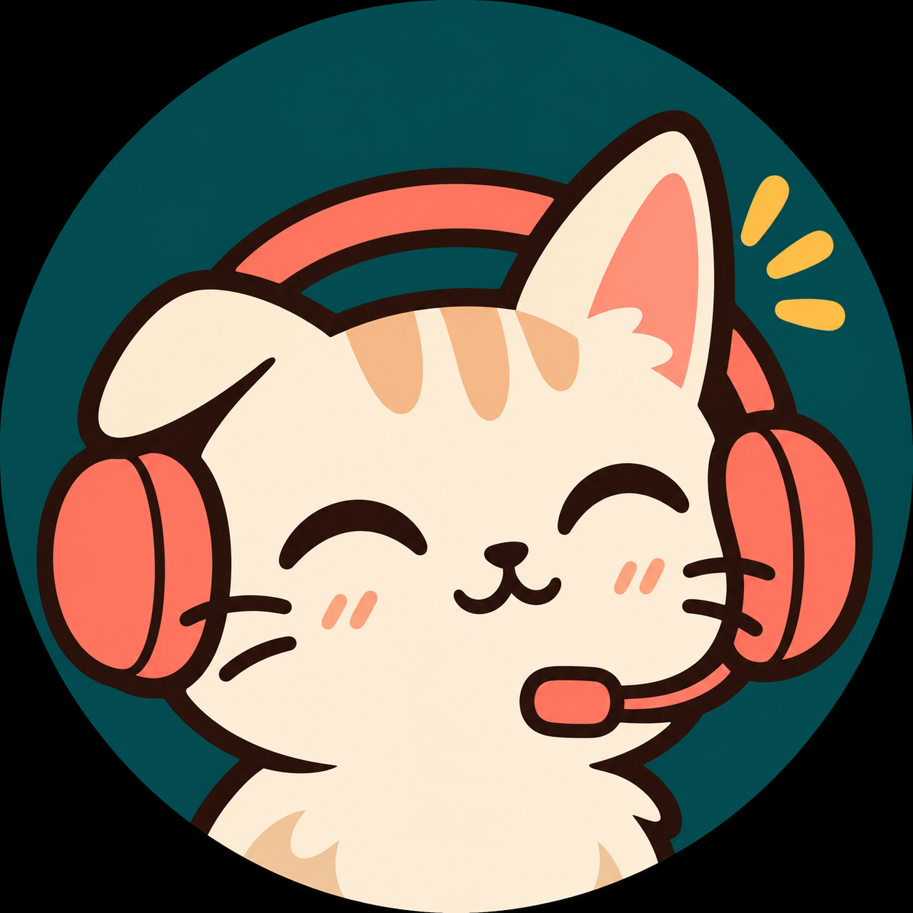

# haru-discord



하루는 Apple Silicon Mac에서 실행하는 한국어 Discord 음성 봇입니다. 마이크로 “하루야, 7 더하기 5는 얼마야?”라고 묻거나 등록한 채팅 채널에 같은 질문을 쓰면, 하루가 연결된 음성 채널에서 “열둘이야”처럼 소리 내어 답합니다.

| `HARU_VOICE_BACKEND` | 동작 |
| --- | --- |
| `gemma-yuna` | 한국어 대화에 사용하는 구성. Qwen3-ASR로 참가자별 음성을 전사하고 Gemma 4 E4B로 답을 생성해 macOS 유나 목소리로 읽습니다. 마이크와 채팅이 같은 통화의 문맥을 공유합니다. |
| `haru` | 환경 설정의 기본값. 공식 Haru-4B MLX 8비트 모델이 참가자의 음성을 하나의 스트림으로 받아 직접 듣고 말합니다. 호출어 없이 대화하는 전이중 모델을 실험할 때 선택합니다. |

## 설치와 실행

Apple Silicon Mac, Git, Node.js 22.12 이상, Python 3.12와 `uv`를 준비합니다. Gemma·유나 모드는 음성 합성을 위해 macOS의 유나 음성과 Xcode 명령줄 도구도 사용합니다.

```sh
git clone https://github.com/pileuszu/haru-discord.git
cd haru-discord
./scripts/haru bot-setup
cp -n .env.example .env
chmod 600 .env
```

1. Discord Developer Portal에서 봇을 만들고 로컬 `.env`에 `DISCORD_TOKEN`, `DISCORD_APPLICATION_ID`, `DISCORD_GUILD_ID`를 설정합니다. 일반 채팅에 쓴 호출어를 읽게 하려면 앱의 **Bot → Message Content Intent**를 켭니다.
2. **Gemma·유나**를 사용하려면 `HARU_VOICE_BACKEND=gemma-yuna`로 설정하고 STT와 Gemma 가중치, 유나 음성을 준비합니다. 동봉된 `stream-local/`을 사용하며, 별도 설치본을 쓸 때는 `HARU_STREAM_LOCAL_DIR`에 절대 경로를 지정합니다. [Gemma·유나 설치 및 모델 설정](stream-local/README.md)
3. **Haru-4B**를 선택했다면 `HARU_VOICE_BACKEND=haru`를 유지하고 아래 명령을 실행합니다. 참조 음성을 직접 준비한 경우에는 마지막 명령 대신 사용할 권리가 있는 단일 화자 음성 파일을 `HARU_REFERENCE_PATH`에 지정합니다. 한국어와 8비트 설정은 각각 `HARU_LANGUAGE=ko`, `HARU_QUANTIZE=8`입니다. [참조 음성 준비](docs/voice-reference.md)

```sh
# Haru-4B 백엔드를 선택한 경우
./scripts/haru setup
./scripts/haru download
./scripts/haru demo-voice
```

백엔드 준비가 끝나면 아래 명령을 순서대로 실행합니다. `bot-invite`가 출력한 링크를 서버 관리자가 열어 하루에게 **채널 보기·연결·말하기** 권한을 부여합니다. `bot-register`는 해당 서버에 슬래시 명령을 등록합니다. [Discord 설정 안내](docs/discord-setup.md)

```sh
./scripts/haru bot-doctor
./scripts/haru bot-invite
./scripts/haru bot-register
./scripts/haru bot
```

## Discord에서 대화하기

1. 일반 음성 채널에 들어가 `/haru join`을 실행합니다. 서버 멤버 누구나 사용할 수 있습니다.
2. Gemma·유나 모드에서 “하루야”, “하루”, “하루찡”, “하루짱”으로 말을 시작하세요. 이름부터 부르면 같은 사람이 5초 안에 시작한 다음 질문 한 건을 받습니다. 맥은 호출어를 알아듣기 위해 각 참가자의 음성을 실시간으로 전사합니다.
3. 글로 묻고 싶다면 `/haru chat add`에서 일반·공지 채널 또는 음성 채널 안의 채팅을 선택합니다. 등록된 곳에 `하루야, 대한민국의 수도는 어디야?`처럼 쓰면 유나가 통화에서 답합니다. 마이크로 이어서 물어봐도 같은 사람의 발화로 기억합니다.
4. 최신 뉴스나 날씨가 필요한 질문은 Gemma가 검색 여부를 판단합니다. 조회할 때는 통화에서 잠깐 기다려 달라고 한 뒤 검색어만 외부 서비스에 보냅니다.

| 명령 | 용도 |
| --- | --- |
| `/haru join` · `/haru leave` | 내 음성 채널에서 대화를 시작하거나 현재 통화를 종료 |
| `/haru status` · `/haru reset` | 음성 연결·처리 상태를 확인하거나 현재 문맥을 초기화하고 다시 연결 |
| `/haru chat add` | 글로 하루를 부를 채널을 한 번에 최대 25개 선택 |
| `/haru chat list` · `/haru chat remove` | 내가 볼 수 있는 등록 채널을 조회하거나 선택한 채널 해제 |

채팅 채널 목록은 처음에 비어 있고 재시작해도 유지됩니다. 일반·공지 채널의 작성자는 하루가 있는 음성 채널을 보고 입장할 권한이 있어야 합니다. 음성 채널에 딸린 채팅은 하루가 그 방에 들어와 있을 때 사용할 수 있습니다.

## 개발과 검증

- Discord 명령·권한·음성 전송 테스트는 저장소 루트에서 `npm test`로 실행합니다.
- Gemma·유나 Python 테스트는 설치 뒤 `cd stream-local`에서 `.venv/bin/python -m unittest discover`로 실행합니다. 같은 디렉터리의 브라우저 대화 화면에서도 모델의 입출력을 시험할 수 있습니다. [로컬 대화 도구](stream-local/README.md)
- Haru-4B 환경에서는 `./scripts/haru test`로 Node·Python 테스트를, `./scripts/haru smoke-ko`로 실제 모델의 한국어 합성 입력 시험을 실행합니다. `bot-smoke`와 `session-smoke`는 각각 로컬 음성 브리지와 Discord 세션의 Opus 경로를 점검합니다. [Haru 분석](docs/haru-analysis.md) · [로컬 검증 기록](docs/local-validation.md)

Haru-4B 실험에 사용하는 공식 코드와 가중치의 리비전은 `runtime.json`에 고정돼 있습니다. [Haru 공식 코드](https://github.com/higurashi-ai/Haru) · [Haru-4B 모델 카드](https://huggingface.co/higurashi-ai/Haru-4B) · [공식 기술 블로그](https://blog.higurashi.ai/melte/haru4b/)
